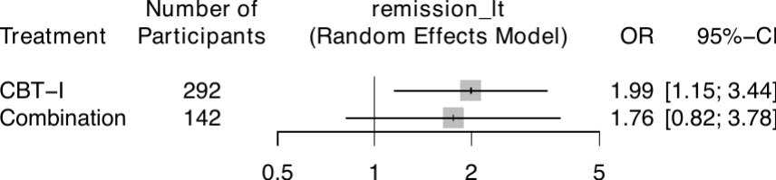
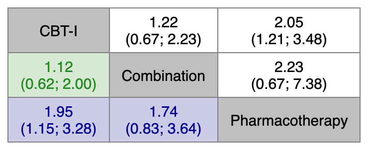
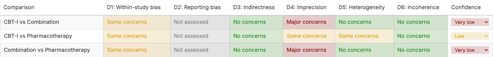

# nmatools

R package providing one-stop wrappers for network meta-analysis (NMA) using the
`netmeta` package: a scripted pipeline that fits a network and writes a complete
set of results and publication-ready figures to disk, a suite of publication
visualizations, and an interactive CINeMA + ROB-MEN Shiny GUI for rating
confidence in the results. It also fits Bayesian component network
meta-analysis (cNMA) in JAGS, formerly the separate `bcnma` package
(**under development**; see below).

## Documentation

The full user manual lives in [`docs/manual/`](docs/manual/README.md). Start at
the [manual home](docs/manual/README.md) for reading paths, or jump to a chapter
below.

**Getting started**

| Chapter | Topic |
|---|---|
| [1. Installation and quick start](docs/manual/01-installation.md) | Requirements, install, five-minute NMA |
| [2. Data formats](docs/manual/02-data-formats.md) | Input formats, `w2i_trials`, helpers, project setup |

**Scripted pipeline**

| Chapter | Topic |
|---|---|
| [3. The NMA pipeline](docs/manual/03-nma-pipeline.md) | `netmetawrap()` arguments, outputs, overrides, subnetworks |
| [4. Batch runs and rare events](docs/manual/04-batch-and-rare-events.md) | `run_nma_batch()` and the Mantel-Haenszel rare-event workflow |
| [5. Transitivity](docs/manual/05-transitivity.md) | `plot_transitivity()` covariate plots |

**GUI guide**

| Chapter | Topic |
|---|---|
| [6. GUI overview](docs/manual/06-gui-overview.md) | Launch modes and workflow |
| [7. Configuration tab](docs/manual/07-gui-configuration.md) | Loading data, NMA and ROB-MEN settings, running |
| [8. CINeMA domains](docs/manual/08-gui-cinema-domains.md) | Domain tabs ①③④⑤⑥ |
| [9. ROB-MEN](docs/manual/09-gui-robmen.md) | Domain ② and the ROB-MEN assessment |
| [10. Report and export](docs/manual/10-gui-report-export.md) | Summary grid, figures, ZIP bundle |

**Visualizations**

| Chapter | Topic |
|---|---|
| [11. Colored league tables](docs/manual/11-league-tables.md) | `color_league()` / `color_league_multi()` |
| [12. Colored forest and network graphs](docs/manual/12-colored-forest-netgraph.md) | `color_forest()` / `color_netgraph()` / palettes |
| [13. Kilim and Vitruvian plots](docs/manual/13-kilim-vitruvian.md) | `kilim()` / `vitruvian()` |

**Evidence frameworks**

| Chapter | Topic |
|---|---|
| [14. Evidence frameworks](docs/manual/14-evidence-frameworks.md) | `min_context()` / `part_context()` |

**Reference**

| Chapter | Topic |
|---|---|
| [15. Troubleshooting and FAQ](docs/manual/15-troubleshooting.md) | Common problems by symptom |
| [16. Function reference](docs/manual/16-function-reference.md) | All exported functions and the literature reference list |

**Bayesian component NMA**

| Chapter | Topic |
|---|---|
| [17. Bayesian component NMA](docs/manual/17-bayesian-cnma.md) (under development) | `bcnma_bin()` / `bcnma_cont()`, component values, effect modifiers |

## Install

```r
# Install from GitHub (recommended)
# install.packages("remotes")   # if not yet installed
remotes::install_github("ykfrkw/nmatools", force = TRUE)
```

Dependencies (`netmeta`, `meta`, `dplyr`, `writexl`, `magick`, and others) are
installed automatically. Requires R ≥ 4.1 and a recent `netmeta` (≥ 3.x); see
[Chapter 1](docs/manual/01-installation.md).

## Quick start

A single `netmetawrap()` call fits the NMA for one outcome and writes every
result — the fitted model, consistency tests, a league table, and a set of
publication-ready plots — to `./outputs/{outcome}/`.

```r
library(nmatools)

d <- load_w2i()   # bundled W2I insomnia sample data (Furukawa et al. 2024)

netmetawrap(
  data            = d,
  studlab         = "id",
  treat           = "t",
  outcome         = "remission_lt",  # also names the output sub-directory
  n               = "n",
  event           = "r",
  sm              = "OR",
  reference.group = "Pharmacotherapy",
  small.values    = "undesirable"
)
# → results are written to outputs/remission_lt/
```

Random-effects models estimate tau^2 by **REML** by default (as in the GUI);
pass `netmeta_args = list(method.tau = "DL")` to change it. See
[NEWS.md](NEWS.md) for recent changes.





See [Chapter 3](docs/manual/03-nma-pipeline.md) for the full output-file table
and override hooks, and [Chapter 4](docs/manual/04-batch-and-rare-events.md) to
run many outcomes at once with `run_nma_batch()`.

## Interactive GUI (CINeMA + ROB-MEN)

`cinema()` launches a Shiny application for interactive confidence assessment,
implementing CINeMA (Nikolakopoulou et al. 2020) and ROB-MEN (Chiocchia et al.
2021). Launch it empty or pre-load a data frame, then work left to right through
the domain tabs to the Report and export bundle — see
[Chapters 6–10](docs/manual/06-gui-overview.md).

```r
library(nmatools)

cinema()                                          # launch empty; upload in the GUI
cinema(load_w2i(), format = "binary", effect_measure = "OR")   # pre-load from R
```



## Bayesian component NMA (formerly bcnma)

> [!WARNING]
> **The Bayesian component NMA functions (`bcnma_bin()`, `bcnma_cont()` and
> related helpers) are under active development.** A methodological review is
> in progress; defaults (priors, labelling of the heterogeneity parameter,
> handling of mean differences, reproducibility of `seed`) and outputs may
> change without notice. Do not use them for published analyses yet. The
> frequentist NMA tools in this package are not affected.

`bcnma_bin()` (binary outcomes, OR) and `bcnma_cont()` (continuous outcomes,
SMD or MD) fit Bayesian random-effects component NMA in JAGS: each treatment
is split into its components (`"se+sd+cr"`) and the effect of each component
is estimated. Interactions between components are handled by an additive
model, spike-and-slab (SSVS) "LASSO" priors on every pair, or SSVS on a chosen
subset (`interactions = "none"`, `"lasso"`, `"lasso_informative"`).
`compare_combinations()` gives the posterior effect of any combination against
another; `forest()`, `plot_interactions()` and `summarise_interactions()`
summarize the fit.

**Requirement:** fitting needs the [JAGS](https://mcmc-jags.sourceforge.io/)
system library and the suggested packages `rjags` and `MCMCvis`
(`install.packages(c("rjags", "MCMCvis"))`; `ggrepel` optional). They are not
installed with nmatools and nothing else in the package needs them.

```r
library(nmatools)

dat <- read.csv(system.file("extdata", "bcnma", "data_CBTICNMA.csv",
                            package = "nmatools"))
names(dat)[1] <- "study"   # fix the BOM character in the first column name

fit <- bcnma_bin(dat, studlab = study, treat = treatment_component,
                 event = r, n = n,
                 components = c("se", "sd", "cr", "th", "cw", "sr", "sc", "re",
                                "pi", "w", "ns", "he", "tg", "ind", "gp", "ff",
                                "ae"),
                 inactive = "dt",   # token in the data that is not a component
                 interactions = "lasso", seed = 42)
print(fit)
forest(fit)
compare_combinations(fit, combo1 = c("se", "sd", "cr", "th", "sr", "sc"),
                     combo2 = "se")
```

Two optional arguments extend the model:

- **`component_values`** replaces the 0/1 component indicators with values
  such as the number of sessions, so `d[k]` is the effect per unit of
  component *k* (linear dose-response).
- **`modifiers`** adds arm-level effect modifiers of specific components,
  continuous (centred) or ordinal (cumulative coding, optionally monotone).
  `d[k]` of a modified component is then its effect **at the center
  (continuous) or the reference level (ordinal)**, and `beta` is the change
  per covariate unit or level step; evaluate other values with
  `compare_combinations(..., at = list(label = value))`.

Modifier effects are identified mainly by **between-study** variation in the
covariate (for example a provider's proficiency, which is the same in every arm
of a study). They are observational, ecological associations open to
confounding by other study characteristics, even though the component effects
rest on randomised contrasts; the fitting functions print a note saying so.

The standalone [`bcnma`](https://github.com/ykfrkw/bcnma) package is
superseded by nmatools: function names and arguments are unchanged, so
existing scripts work after replacing `library(bcnma)` with
`library(nmatools)`. See [Chapter 17](docs/manual/17-bayesian-cnma.md).

## Sample data

`w2i_trials` — arm-level data from the Furukawa et al. (2024) W2I NMA. Three
treatments (CBT-I, Combination, Pharmacotherapy) for chronic insomnia; four
binary outcomes (remission and dropout at long-term and post-treatment). The
column dictionary is documented in [Chapter 2](docs/manual/02-data-formats.md).

```r
d  <- load_w2i()            # arm-level trial data
ci <- w2i_cinema_path()     # path to bundled CINeMA CSV (remission_lt only)
```

> Furukawa Y, Sakata M, Furukawa TA, Efthimiou O, Perlis M. Initial treatment choices for long-term remission of chronic insomnia disorder in adults: a systematic review and network meta-analysis. *Psychiatry Clin Neurosci*. 2024;78(11):646-653. https://doi.org/10.1111/pcn.13730

## Citation

nmatools is a wrapper around `netmeta` and `meta`. If you use it in published
research, please also cite those packages directly. The full literature
reference list is in [Chapter 16](docs/manual/16-function-reference.md).

```r
citation("netmeta")
citation("meta")
```
